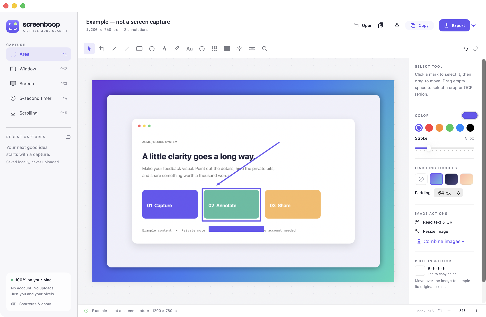

# Screenboop

A local-only, native macOS screenshot utility. Capture something, mark what matters, and copy or export the result—without an account, uploads, or telemetry.



## What it does

- Capture an area, a window, the main display, or the main display after a five-second countdown.
- Make bounded scrolling captures by selecting a region and letting Screenboop scroll it. See the [limitations](docs/usage.md#scrolling-capture).
- Annotate with arrows, lines, shapes, pen, highlighting, text, counters, spotlights, pixel measurements, and magnifying lenses.
- Cover sensitive content with opaque redaction masks; pixelation is available as a separate visual effect.
- Crop, resize, combine images vertically or horizontally, and add a padded gradient backdrop.
- Read text and QR payloads locally with Apple Vision. QR links are never opened automatically.
- Copy a flattened PNG, export PNG or JPEG, or pin an image as a floating reference.

Screenboop is original Swift, AppKit, and SwiftUI code with no third-party dependencies. Shottr's workflows informed the project, not its source code or artwork. This is not a pixel-identical clone or a proprietary-source reconstruction.

## Build and run

### Requirements

- macOS 14 or later.
- Xcode or Apple Command Line Tools providing **Swift 6.0 or later**, plus `make`, `xcrun`, `iconutil`, and `codesign`.
- Screen Recording permission for capture; Accessibility permission only for automatic scrolling.

From a clone of this repository:

```sh
git clone https://github.com/chrisvo/screenboop.git
cd screenboop
make run
```

`make run` builds a release executable, packages `build/Screenboop.app`, generates its icon, applies an ad-hoc signature, and opens the app. `make build` builds the same app without launching it. You can copy the resulting app bundle into Applications if desired.

**Source builds are ad-hoc signed only—not Developer ID signed or notarized.** There is no prebuilt release installation path documented here. macOS may apply restrictions to downloaded or locally built apps; this project does not recommend disabling system security protections.

At first launch, choose **Capture an area** and follow macOS's permission prompt. You can also open an existing image or try the clearly labeled example image without capture permission. [The usage guide](docs/usage.md) covers permissions, shortcuts, and the complete workflow.

Run the permission-free image safety and stitching tests with:

```sh
make test
```

GitHub Actions also builds, tests, and packages a runner-native app artifact. Those artifacts are ad-hoc signed and have the same notarization limitations as local source builds.

## Privacy and redaction

Screenboop processes images and recognition results on your Mac and makes no application network requests. It does not include cloud storage, accounts, payments, or telemetry.

**Capture history saves original, unredacted screenshots.** Adding a Redact mark does not remove those originals or the editor's undo snapshots. Redact masks are baked into copied/exported image pixels; pixelation is not secure redaction. Before sharing sensitive material, review the output and read [the privacy guidance](docs/usage.md#redaction-and-local-history).

## Documentation

- [Usage and troubleshooting](docs/usage.md)
- [Architecture and source ownership](docs/architecture.md)
- [Executed checks and verification limits](docs/verification.md)
- [Contributing](CONTRIBUTING.md)
- [Shottr research findings and evidence limits](docs/shottr-findings.md)

## License

Screenboop is available under the [MIT License](LICENSE). The license covers this repository's original work; it does not grant rights to Shottr or its proprietary resources.
