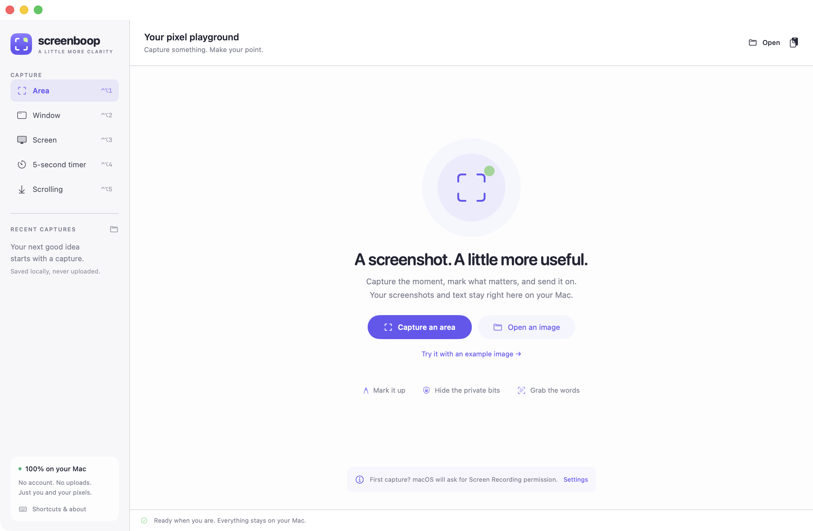
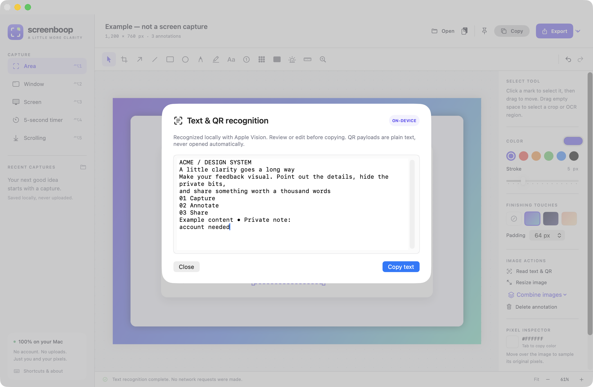

# Using screenboop

Open `screenboop.app` from Applications, or build and launch with `make run` from the repository root. For prerequisites and source-build signing limitations, see the [README](../README.md#build-and-run).

## First capture and permissions

1. Choose a capture in the sidebar, **Capture** menu, or screenboop's menu-bar icon.
2. Allow screenboop in **System Settings → Privacy & Security → Screen & System Audio Recording** (called **Screen Recording** on older macOS).
3. Quit and reopen screenboop if macOS asks you to, then retry.

screenboop hides its editor during capture and returns to it afterwards. Opening images, editing, and OCR do not require screen-capture permission. **Accessibility** permission is requested only for automatic scrolling, so the app can send scroll events into the selected content.

### Global capture shortcuts

| Shortcut | Capture |
| --- | --- |
| Control–Option–1 | Area: drag a region in the macOS picker |
| Control–Option–2 | Window: choose a window in the macOS picker |
| Control–Option–3 | Main display |
| Control–Option–4 | Main display after a five-second countdown |
| Control–Option–5 | Scrolling region |

These shortcuts work while screenboop is running. If another app owns a shortcut, use the sidebar or menu-bar menu instead. Closing the editor does not quit screenboop; reopen it through the menu-bar icon or Dock, or use **screenboop → Quit screenboop** to exit.

Press **Escape** to dismiss an area/window picker or cancel scrolling selection/capture. The scrolling progress panel also has **Cancel**. To stop a countdown, reopen the editor from the menu-bar icon and use **Cancel** in its status bar. A cancelled capture leaves the current image unchanged. In the editor, Escape clears a draft or selection; it does not undo committed annotations.

## Open, paste, and edit

Use **Open** / **Command–O**, drop an image file onto the canvas, or paste an image with **Command–V**. The welcome window's example is generated locally and labeled as an example, not a real screen capture.

Click the canvas to give it keyboard focus before using tool shortcuts. Choose color and stroke size in the inspector **before** placing a mark; these controls set the style for new marks, not the selected mark.

### Tools

| Tool | Key | Gesture and result |
| --- | --- | --- |
| Select | V | Click a mark, then drag to move it. Drag empty space to select a crop/OCR region. |
| Crop | C | Drag the region to keep, then press Return or choose **Crop selection**. |
| Arrow | A | Drag from the tail to the arrowhead. |
| Line | L | Drag between endpoints. |
| Rectangle | R | Drag an outlined rectangle; hold Shift for a square. |
| Ellipse | O | Drag an outlined ellipse; hold Shift for a circle. |
| Pen | P | Draw a freehand stroke; a click makes a dot. |
| Highlight | H | Drag a translucent highlighted rectangle. |
| Text | T | Click a position, enter text, and choose **Add text**. Stroke size controls text size. |
| Counter | N | Click to place numbered callouts. |
| Pixelate | B | Drag a region to obscure detail with pixel blocks. This is not secure redaction. |
| Redact | X | Drag a region to replace its pixels with an opaque color mask in the output. |
| Spotlight | S | Drag a region to leave bright while dimming the rest of the image. |
| Measure | M | Drag between points to label their distance in physical image pixels. |
| Magnify | Z | Drag a circular 2× lens, or click for a default-sized lens. |

Use **V** to select a mark and **Delete** to remove it, or choose **Delete annotation** in the inspector. Marks can be moved and deleted, but do not have resize handles; the selection outline's corner squares are not resizing controls. Delete and redraw a mark to change its geometry or style.

### Crop, undo, zoom, and pan

- A rectangular selection made with **Select** or **Crop** can be cropped with **Return**. **Command–A** selects the whole image when the canvas is focused.
- Cropping and resizing flatten the current annotations into the image. **Command–Z** restores the previous editable document; **Shift–Command–Z** redoes a change. Undo history is bounded to 30 document snapshots and is not saved as an editable project.
- **Command–1** fits the image; **Command–0** shows actual pixels. Use the footer's minus/plus buttons or **View → Zoom in/out** for other scales.
- Pan with **Space–drag**, **right–drag**, or the scrollbars.
- Hover over the image to inspect its original sRGB pixel color; **Tab** copies the hexadecimal color. This samples the underlying image, not annotations or the backdrop—including pixels beneath editable redaction marks. After flattening operations, the current underlying image is the flattened result.

The displayed dimensions and measurement labels are image pixels, not macOS screen points. A Retina capture can contain more pixels than its on-screen size in points.

## Redaction and local history

**Use Redact, not Pixelate, for private content.** Pixelation only obscures detail and must not be treated as a privacy boundary. A Redact mark forces an opaque fill regardless of selected color transparency. Copied/exported images flatten that mask into pixels, and magnifier/pixelation effects use a masked source so they cannot reveal the covered source through their output.

Redaction is an output operation, not deletion of every local copy:

- New screen captures are automatically saved as **original, unredacted PNGs** in `~/Library/Application Support/screenboop/Captures`.
- The editor's current source image, original-pixel color inspector, and undo snapshots can still contain private content.
- Previously exported images, copied clipboard content, and existing pins do not change when you edit the document.
- **Clear history…** in the sidebar asks for confirmation and removes the PNG capture entries in screenboop's capture folder. It does not alter the current editor image, undo history, exports elsewhere, pins, or clipboard, and is not a secure-erasure guarantee.

Review the exported image before sharing it. Clear sensitive history when appropriate; load another image to replace the current document and reset its undo stack, close old pins, and replace clipboard contents separately if needed. Copies outside screenboop's history remain your responsibility.

Recent captures can be reopened from the sidebar. Its folder button or **File → Show capture history** opens the storage folder. History contains captured originals, not a saved annotation project; opening an existing file or pasting an image does not automatically add it to capture history.

## Text and QR recognition

Choose **Read text & QR** in Image Actions or **Image → Read text & QR codes** (**Shift–Command–R**). Drag a selection first to limit recognition to that region; otherwise it reads the whole image. Recognition uses the current rendered annotations without the decorative backdrop, including redaction masks.

Apple Vision runs on the local image. Review or edit the result in the sheet and choose **Copy text**. Recognized text and QR payloads are presented as plain text; QR URLs are **never opened automatically**. Recognition can miss small, blurred, stylized, or rotated text and is not an accuracy guarantee.

## Resize, combine, and backdrop

- **Resize image** in Image Actions or **Image → Resize…** accepts physical pixel dimensions. **Keep aspect ratio** is on by default. Resizing flattens annotations; Undo restores them.
- **Combine images → Stack images vertically… / Join images horizontally…** adds selected files after the current image, at their existing pixel sizes. The result uses a white canvas with 20-pixel gaps, aligned left for vertical stacks or top for horizontal joins. Current annotations are flattened and the result starts without a backdrop; Undo restores the prior document.
- **Finishing Touches** offers **None**, **Aurora**, **Midnight**, and **Peach**. A backdrop adds a rounded card and shadow with 32, 64, or 96 pixels of padding. It is included in copy, export, and pins, but excluded from crop, resize, combination, and OCR source rendering.

Images and rendered output are limited to **100 million pixels total** and **32,768 pixels per side**, including added backdrop padding or combination gaps. Smaller images may still be necessary if available memory is limited.

## Copy, export, and pins

| Action | Shortcut |
| --- | --- |
| Copy flattened PNG to the clipboard | Command–C |
| Export PNG | Command–S |
| Export JPEG | Shift–Command–S |
| Pin floating reference | Shift–Command–P |
| Undo / Redo | Command–Z / Shift–Command–Z |

**Copy** and **Export** include annotations and backdrop, not editor controls or selection outlines. JPEG is lossy and composites transparency over white; PNG preserves alpha. The save panel remembers the last export folder. There is no editable-project export, GIF export, or upload action.

In a native text field or the recognition text editor, Command–C/Command–V and undo/redo apply to text rather than the image. Click the canvas to return to image actions.

A pin is a flattened snapshot in a floating, resizable window. Drag it to move, resize its edges, and use its close control to dismiss it. Later document edits do not update existing pins.

## Scrolling capture

1. Allow Screen Recording and **System Settings → Privacy & Security → Accessibility** for screenboop.
2. Start scrolling capture and drag a rectangle **inside one display's scrollable content**, at least 48 × 48 screen points. Exclude fixed sidebars and moving controls when possible.
3. Leave the target window in place and unobstructed. screenboop moves the pointer to the rectangle's center, sends downward scroll events, captures overlapping frames, and aligns them.
4. Wait for the editor to return, or press Escape / **Cancel** to stop without replacing your image.

Capture starts from the target's **current scroll position**; it does not rewind to the top or restore the original scroll position. It is limited to **20 frames**. Stationary content is treated as the bottom; the result may instead stop at the frame limit before the page ends. Static header/footer matching attempts to retain those bands once. Unmatched or ambiguous overlaps fail rather than append an unaligned frame.

This is vertical scrolling within a fixed rectangle, not full-page browser export. Animation, repeated/blank rows, changing sticky UI, nested scrollers, or window movement can prevent a reliable match. Select a smaller, distinctive content region and retry. Real acquisition has been exercised with a controlled scrollable native window; this does **not** establish compatibility with every app, browser, sticky layout, or secondary display.

## Troubleshooting

| Symptom | What to try |
| --- | --- |
| Capture permission error | Enable screenboop in the Screen Recording privacy pane; restart it if macOS requests, then retry. |
| Scrolling permission error | Enable screenboop in Accessibility and retry. Ordinary capture does not need this permission. |
| Capture shortcut does nothing | Check screenboop is running; use its menu-bar capture actions if another app owns the shortcut. |
| Native picker closes without opening an image | Escape dismisses it. Avoid holding Control during capture: macOS may choose clipboard-only output, leaving the editor unchanged; paste the clipboard image or retry without Control. |
| Scrolling says the content did not move | Move the target above its bottom, select content with a scrollable center, and avoid sidebars. |
| Ambiguous overlap or changing fixed band | Select distinctive, static content without animated or sticky elements; avoid moving or covering the window. |
| Image is too large or allocation fails | Choose a smaller capture or reduce image/backdrop dimensions. The output limits also apply to combined and scrolling images. |
| OCR is empty or inaccurate | Select a clearer region and check that redaction or other marks are not obscuring it; review the result before copying. |
| History is unavailable | Read the reported local filesystem error and check access to the Application Support folder. Editing and export remain available. |
| Build cannot find Swift or reports tools-version errors | Install/select an Apple developer toolchain that provides Swift 6.0 or later, then run `make run` again. |

For implementation details, see [Architecture](architecture.md). For what was—and was not—observed about the inspiration app, see [Shottr findings](shottr-findings.md).
